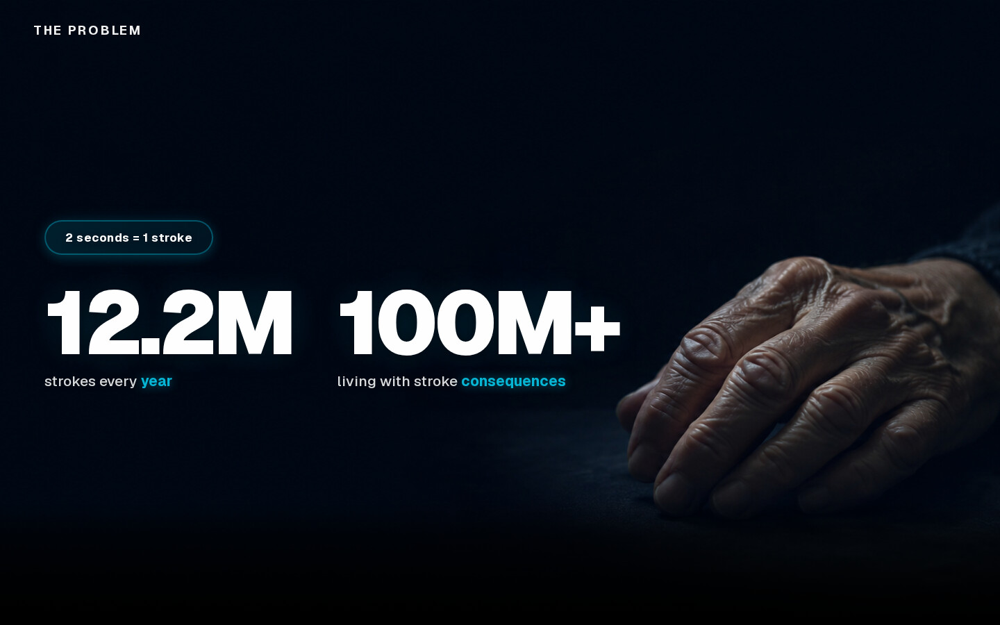
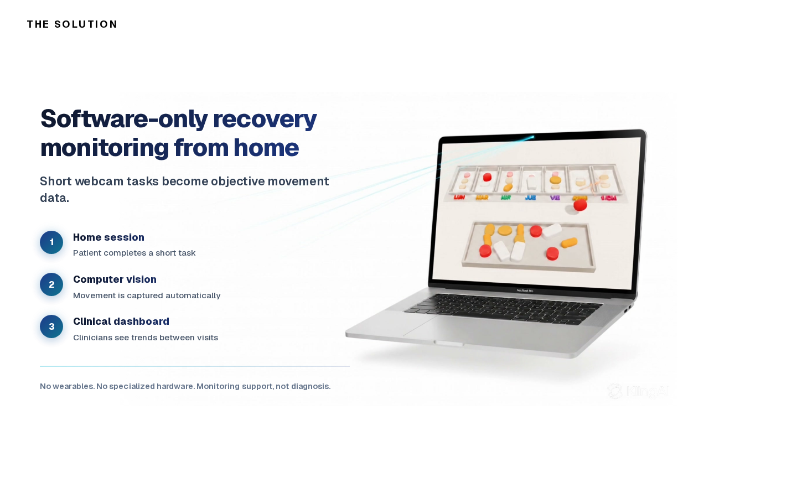
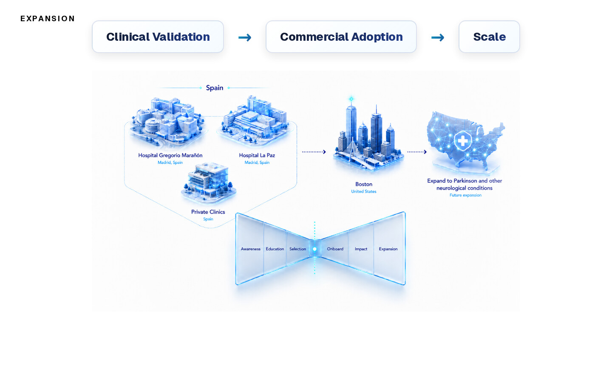

# FixedGap Harvard Pitch

A scroll-driven web presentation of FixedGap, built for a pitch at Harvard on 11 June 2026. Instead of slides, the story plays as a video you move through with the scroll wheel, with text and small interactive pieces layered on top.

Live: https://fixedgapdemo.vercel.app



## What it is

FixedGap is a software-only way to monitor stroke recovery at home: the patient does short tasks in front of a webcam (framed as a game), computer vision turns the movement into functional data, and clinicians see trends between visits. This repo is the pitch for it, not the product itself.

The page walks through the usual pitch sections: the monitoring gap, the "what if" moment, the solution, a clinical view, business plan, traction and milestones, then the team and the pre-seed ask. It was built in a few days by the team for the Harvard Health Systems Innovation Lab event.

## How it works

- A 759-frame video (`public/frames/`) is loaded in batches of 20 and drawn to a full-screen `<canvas>`. Scroll position maps to a frame index, so scrolling plays the video forward or backward.
- Seven key frames are "snap" points. Near them the page locks briefly, swaps in a sharper PNG from `public/frames-hq/`, and fades in that section's overlay.
- The first 313 frames are shown full-screen with white text; from frame 314 the image shrinks to 70% on a white background and text switches to dark.
- Custom overlays include a typewriter line, an SVG chart of what gets observed in clinic versus at home, a three-step "how it works" strip, a traction block and a counter that animates the funding ask.
- After the video, two normal sections follow: team and the ask.
- Everything is client-side; there is no backend and no data collection.



The solution snap point, with the overlay fully faded in.



The expansion slide, later in the scroll, where the video frame is shown at 70% on white.

## Stack

Next.js 16 (App Router), React 19, TypeScript, Tailwind CSS v4, Framer Motion.

## Run it

```bash
npm ci
npm run build
npm run start
```

Then open http://localhost:3000. Frames total about 85 MB, so the first load takes a moment; a progress bar shows while they load.

## Team

- Luis Molina Salvador
- Mateo Perez
- alvarog-prog
